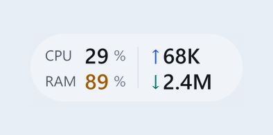
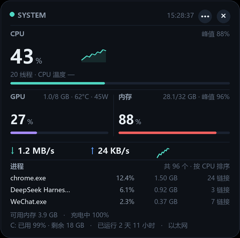
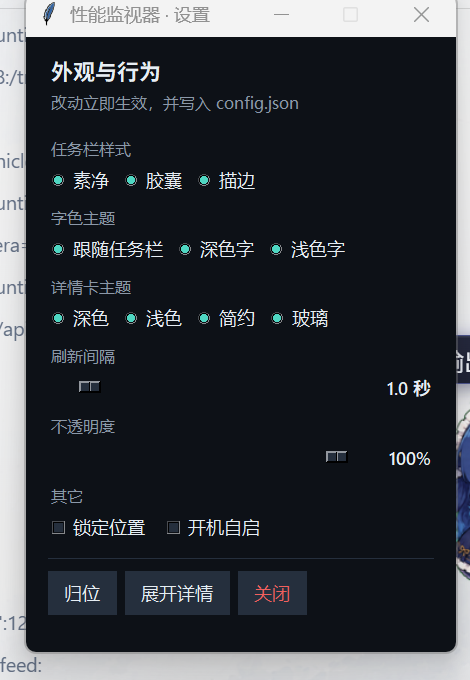

<div align="center">


# 桌面性能监视器

**嵌在 Windows 任务栏里的一行实时性能数据**


<br>



<sub>贴在托盘左边，背景真透明，看不出是浮窗</sub>

</div>

---

## 它能做什么

- **嵌进任务栏**：CPU / 内存 / 上传 / 下载，两行四格，一秒一刷
- **点一下看详情**：CPU、GPU、内存、网速曲线、Top 进程、温度、磁盘、电池
- **三套样式 + 四套主题**：素净 / 胶囊 / 描边；详情卡深色 / 浅色 / 简约 / 玻璃
- **进程列表可展开**：默认 3 行，点表头展开到 8 行
- **零服务零联网**：采样全走 Windows API，只有渲染用 Pillow
- **崩溃自愈**：看门狗每 3 分钟检查，进程没了自动拉起

---

## 详情卡

<div align="center">



</div>

- CPU 占用、峰值、60 秒曲线
- GPU 占用 / 显存 / 温度 / 功耗（走 `nvidia-smi`）
- 内存占用、峰值、总容量
- 实时上下行 + 流量曲线
- Top 进程：名称 / CPU / 内存 / 活跃连接数
- 页脚：可用内存、电池、磁盘、开机时长、网卡

---

## 设置

<div align="center">



</div>

入口是详情卡右上角的 `···`：

- 任务栏样式：素净 / 胶囊 / 描边
- 字色主题：跟随任务栏 / 深色字 / 浅色字
- 详情卡主题：深色 / 浅色 / 简约 / 玻璃
- **滑块调刷新间隔**（0.5–5 秒）和**不透明度**（30%–100%）
- 锁定位置、开机自启

---

## 快速开始

**直接下载**：到 [Releases](https://github.com/1181110317/desktop-monitor/releases/latest) 拿 `DesktopMonitor.exe`，放在**纯英文路径**（如 `%LOCALAPPDATA%\Programs\DesktopMonitor\`）下双击即可。

**从源码跑**：

```bash
pip install pillow
python monitor.pyw
```

**自己打包**（目录也用纯英文路径，否则 PyInstaller 会找不到图标）：

```bash
pyinstaller --noconfirm --onefile --windowed --icon icon.ico --name DesktopMonitor monitor.pyw
```

---

## 技术实现

单文件 `monitor.pyw`，约 2300 行。

| 部分 | 用的东西 |
| --- | --- |
| 采样 | `GetSystemTimes`、`GlobalMemoryStatusEx`、`GetIfTable2`、`GetDiskFreeSpaceExW`，GPU 走 `nvidia-smi` |
| 进程 | `CreateToolhelp32Snapshot` + `GetProcessTimes` / `GetProcessMemoryInfo`，连接数来自 `GetExtendedTcpTable` |
| 任务栏停靠 | `SHAppBarMessage` + `EnumChildWindows` 找托盘位置 |
| 渲染 | Pillow 超采样；任务栏那层用 **WS_EX_LAYERED + UpdateLayeredWindow** 做逐像素透明 |
| 托盘 | `Shell_NotifyIconW` + 自定义 `WndProc` |

踩过的坑（都写在代码注释里）：

- `W` 后缀 API 不声明原型，64 位下参数溢出会让回调返回 0，直接 BEX 崩溃
- `MIB_IF_ROW2` 的 `OutOctets` 偏移与文档不符（实际 1280），上传速度才会一直是 0
- `WndProc` 里调 Tk 会重入 Tcl，进程每 1–2 分钟崩一次；改成投递队列后才稳
- Tk 的透明色键做不出半透明边缘，任务栏那层必须换分层窗口

---

## 许可

MIT © 1181110317
