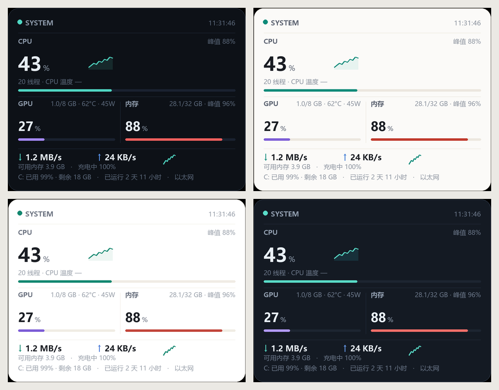
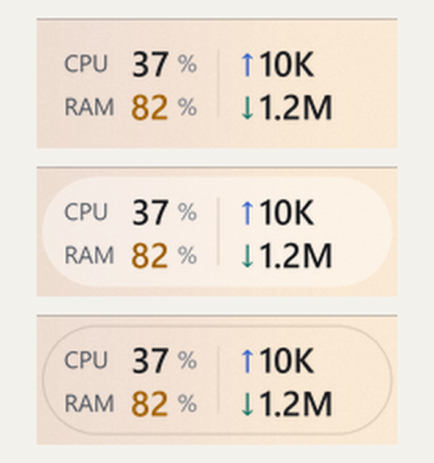

<div align="center">


# 桌面性能监视器 · DesktopMonitor

**嵌在 Windows 任务栏里的一行实时性能数据 · CPU / 内存 / 网速 / GPU / 温度**


</div>

<div align="center">

<br>
<sub>直接嵌在任务栏空白处，和任务栏图标同一行，看不出是一层浮窗</sub>
</div>

---

## ✨ 特性

| | |
| --- | --- |
| 🧩 **真·嵌进任务栏** | 不是悬浮在任务栏上面，而是贴在托盘左侧的任务栏空白处，背景与任务栏无缝衔接 |
| 🖱️ **点一下看详情** | 点任务栏上的数字 → 详情卡弹在正上方，任务栏本身不消失 |
| 🎨 **三套样式 × 四套主题** | 素净 / 胶囊 / 描边；详情卡支持深色 / 浅色 / 简约 / 玻璃 |
| 📊 **该有的都有** | CPU 占用与峰值、内存、上下行网速、GPU 占用 / 显存 / 温度 / 功耗、C 盘、运行时长、电池 |
| 🪶 **零外部依赖** | 全部采样走 Windows API，只有渲染用 Pillow；单文件 2000 行，无框架无服务 |
| 🔁 **崩溃自愈** | 附带的看门狗每 3 分钟检查一次，进程没了自动拉起 |
| 🖥️ **高 DPI 友好** | 按系统缩放渲染，4K 下不糊；多显示器也能正确贴边 |
| 🔒 **本地运行** | 不联网、不上传、不弹窗广告 |

---

## 📸 预览

### 展开详情（独立弹窗，任务栏不动）


### 详情卡四种主题



| 主题 | 观感 |
| --- | --- |
| **深色** | 近黑卡片，默认 |
| **浅色** | 暖白底 + 深色字 |
| **简约** | 纯白极简，分隔线几乎不可见 |
| **玻璃** | 深蓝灰，整窗 94% 不透明 |

### 任务栏三种样式



| 样式 | 说明 |
| --- | --- |
| **素净** | 只有文字，无底片 |
| **胶囊** | 一层很淡的圆角底片（默认） |
| **描边** | 只画一圈极淡的描边 |

### 设置窗口


---

## 🚀 快速开始

### 方式一：直接用打包好的程序

1. 到 [**Releases**](https://github.com/1181110317/desktop-monitor/releases/latest) 下载 `DesktopMonitor.exe`
2. 放到**纯英文路径**下（例如 `%LOCALAPPDATA%\Programs\DesktopMonitor\`），中文路径会导致程序启动失败
3. 双击运行，程序会自动把自己贴到任务栏

> 首次运行会在同目录生成 `config.json` 保存设置。

### 方式二：从源码运行

```bash
pip install pillow
python monitor.pyw
```

需要 Windows + Python 3.9+。窗口版无控制台，加 `--selftest` 可在终端打印一次采样结果：

```bash
python monitor.pyw --selftest
```

### 方式三：自己打包

```bash
pip install pyinstaller pillow
pyinstaller --noconfirm --onefile --windowed --icon icon.ico --name DesktopMonitor monitor.pyw
```

> ⚠️ 打包目录请在**纯英文路径**下，否则 PyInstaller 处理中文路径会报找不到图标。

---

## 🎛️ 操作

| 操作 | 效果 |
| --- | --- |
| 左键点任务栏上的数字 | 展开 / 收起详情 |
| 点详情卡 `···` | 打开设置窗口 |
| 点详情卡 `×` / `Esc` / 点空白处 | 关闭详情 |
| 右键任务栏那块 / 托盘图标 | 弹出菜单 |
| 双击悬浮卡片 | 在完整卡片和紧凑条之间切换 |

设置窗口里可以改：任务栏样式、字色主题、详情卡主题、刷新间隔、不透明度、锁定位置、开机自启。

配置文件 `config.json` 就放在 exe 旁边，删掉即恢复默认。

---

## 🔬 技术实现

整个程序就一个文件 `monitor.pyw`（约 2000 行），分几块：

| 模块 | 干什么 | 用的 API |
| --- | --- | --- |
| `Stats` | CPU / 内存 / 网速 / 磁盘 / 运行时长 | `GetSystemTimes` `GlobalMemoryStatusEx` `GetIfTable2` `GetDiskFreeSpaceExW` `GetTickCount64` |
| `GpuReader` | GPU 占用、显存、温度、功耗、风扇 | `nvidia-smi -lms 900` 流式输出，独立线程 |
| `TempReader` | CPU 温度 | LibreHardwareMonitor / ACPI 兜底 |
| `TrayIcon` | 托盘图标与消息 | `Shell_NotifyIconW` + 自定义 `WndProc` |
| `MonitorApp` | 停靠、绘制、交互 | `SHAppBarMessage` `EnumChildWindows` `SetWindowPos` + Pillow |

几个踩过的坑，也记在这：

- **任务栏停靠**：`SHAppBarMessage(ABM_GETTASKBARPOS)` 拿任务栏矩形，`EnumChildWindows` 找 `TrayNotifyWnd` 定位托盘左边缘，窗口用 `overrideredirect` + 透明键色，"贴"在任务栏空白区。
- **不被任务栏盖住**：`GetWindow(hwnd, GW_HWNDPREV)` 判断不可靠（会被画布子窗口干扰），改成用 `WindowFromPoint` 问系统"这个点属于谁"，不是自己就 `SetWindowPos(HWND_TOPMOST)`，150ms 检查一次。
- **不闪烁**：早期每秒 `delete("all")` 重画画布，透明窗口会闪；现在整帧用 Pillow 渲染成一张图，只替换图像内容；且内容不变就不重绘。
- **64 位崩溃**：`FindWindowW` / `GetClassNameW` 这类 `W` 后缀 API 不写 `argtypes`，Python 字符串会被当 ANSI 指针传进去，原生代码按 UTF-16 读到越界 → `0xc0000409`。全部补上原型后稳定。
- **上传速度读错**：`MIB_IF_ROW2` 的 `OutOctets` 字段偏移与结构体声明不一致（实测在 1280，不是 1216），按声明读会一直读到几乎不动的计数器，测速时上传永远显示几百字节。

---

## ❓ 常见问题

<details>
<summary><b>任务栏那块突然不见了？</b></summary>

先等 3 分钟——看门狗会自动拉起。也可以直接双击桌面快捷方式。

如果频繁发生，把 `error.log` 发出来，异常都记在里面。
</details>

<details>
<summary><b>测速时上传速度和测速网站对不上？</b></summary>

先换算单位：测速网站的 100 Mbps ≈ 本程序的 12.5 MB/s。

注意本程序统计的是**整机网卡流量**，测速软件本身的开销、后台更新、局域网传输都会算进去。
</details>

<details>
<summary><b>CPU 温度显示 "—"？</b></summary>

Windows 没有公开的 CPU 温度接口。本程序优先读 LibreHardwareMonitor 的 WMI，其次尝试 ACPI 热区；两者都不可用时会显示 `—`，不影响其它数据。
</details>

<details>
<summary><b>为什么 exe 有 31 MB？</b></summary>

因为打包了 Pillow（抗锯齿文字渲染）。纯 Tk 文字能省掉 25 MB，但字会有锯齿。
</details>

<details>
<summary><b>怎么彻底卸载？</b></summary>

右键 → 退出（会写入 `disabled.flag`，看门狗不再拉起），然后删除：
- 安装目录 `%LOCALAPPDATA%\Programs\DesktopMonitor\`
- 计划任务 `DesktopMonitorWatchdog`
- 桌面 / 开始菜单快捷方式
</details>

---

## 📁 项目结构

```
desktop-monitor/
├─ monitor.pyw            # 全部源码（采样 + 绘制 + 交互）
├─ icon.ico / icon.png    # 图标
├─ docs/images/           # README 截图
└─ tools/
   ├─ shot.ps1            # 截图小工具
   ├─ ui_selftest.py      # 界面自检
   └─ modes_test.py       # 四种显示模式切换测试
```

---

<div align="center">
<sub>用 Python 标准库 + Pillow 手搓的任务栏监控 · 如果觉得有意思，给个 ⭐ 吧</sub>
</div>
